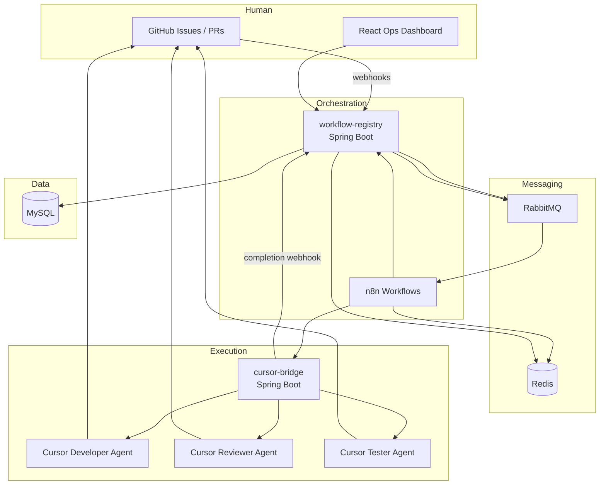
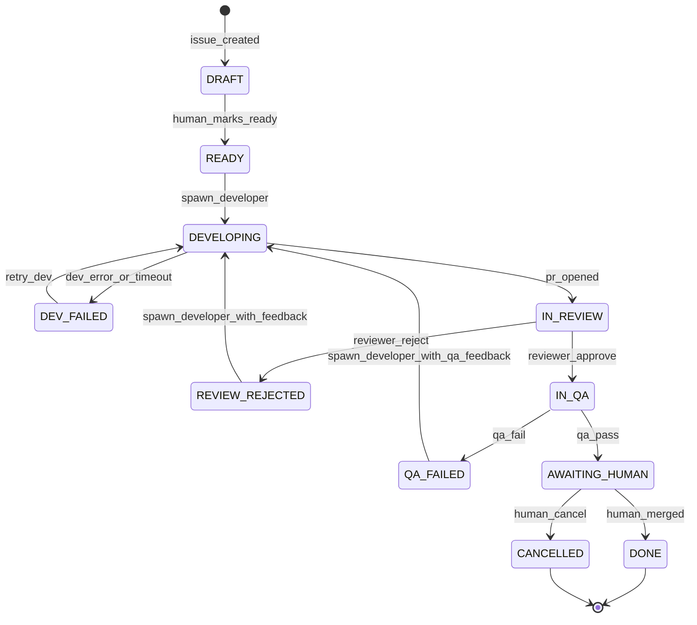

# Architecture: n8n-Orchestrated Multi-Agent SD Platform

## 1. Goals and non-goals

### Goals

- Predictable, auditable SD lifecycle from GitHub Issue → PR → review → QA → human merge.
- Clear separation: **orchestration (n8n + registry)** vs **execution (Cursor Cloud Agents)**.
- Idempotent handoffs: every external callback keyed by `task_id` + `execution_id` + `idempotency_key`.
- Full traceability: state history, agent run IDs (`bcId`), commit SHAs, PR URLs.

### Non-goals (v1)

- Replacing human merge authority (agents never merge to protected branches).
- Letting any agent mutate workflow state directly (only registry API + n8n).
- Using an LLM inside n8n for routing decisions (deterministic rules only).

---

## 2. High-level architecture (HLD)



### Component responsibilities

| Component | Role |
|-----------|------|
| **GitHub App** | Issues, PRs, checks, labels; webhook source of truth for repo events |
| **workflow-registry** | System of record: tasks, executions, transitions, audit log; publishes domain events |
| **cursor-bridge** | Maps orchestration commands → Cursor Cloud Agent API; normalizes agent outcomes |
| **n8n** | State machine driver: when to spawn which agent, retries, timeouts, human gates |
| **RabbitMQ** | Decouple webhooks, n8n, and services; replay-friendly event log (with DLQ) |
| **Redis** | Idempotency keys, short-lived locks, n8n execution dedupe, rate-limit counters |
| **React dashboard** | Task timeline, agent links, approve/reject human gate, retry controls |

---

## 3. Task state machine

States are stored in MySQL; only **workflow-registry** (via n8n-signed requests) may transition them.



**Retry policy (defaults, configurable per repo):**

| Transition | Max attempts | Backoff |
|------------|--------------|---------|
| `DEVELOPING` | 3 | 15m, 1h, 4h |
| `IN_REVIEW` | 2 | immediate (new reviewer run) |
| `IN_QA` | 2 | after CI green |

n8n increments `attempt_no` on each spawn; registry rejects spawn when `attempt_no > max_attempts`.

---

## 4. Low-level design (LLD)

### 4.1 Spring Boot microservices

#### `workflow-registry` (port 8081)

- **Inbound:** GitHub webhooks (HMAC verified), n8n internal API (mTLS or HMAC), cursor-bridge callbacks.
- **Outbound:** RabbitMQ publish, optional GitHub API (labels/comments via installation token).

Key packages:

```
com.platform.workflow
  domain/          Task, Execution, Transition, AgentRun
  api/             TaskController, WebhookController, InternalTransitionController
  persistence/     JPA repositories
  events/          OutboxPublisher → RabbitMQ
  security/        GitHub webhook signature, n8n service token
```

**Internal APIs (n8n only):**

| Method | Path | Description |
|--------|------|-------------|
| `POST` | `/internal/v1/tasks/{taskId}/transition` | Apply transition with idempotency key |
| `POST` | `/internal/v1/tasks/{taskId}/executions` | Record new agent execution |
| `PATCH` | `/internal/v1/executions/{executionId}` | Complete/fail execution |
| `GET` | `/internal/v1/tasks/{taskId}` | Full task + history for n8n decision nodes |

**Public APIs (dashboard):**

| Method | Path | Description |
|--------|------|-------------|
| `GET` | `/api/v1/tasks` | Paginated list with filters |
| `GET` | `/api/v1/tasks/{taskId}` | Detail + timeline |
| `POST` | `/api/v1/tasks/{taskId}/human-approve` | Human merge readiness ack |

#### `cursor-bridge` (port 8082)

- Wraps Cursor **Cloud Agent API** (or Automations API where applicable).
- Accepts: `{ taskId, executionId, role, repoUrl, baseRef, promptTemplateVars, environmentId }`.
- Returns: `{ bcId, agentUrl }`.
- Receives agent completion via:
  - **Preferred:** Cursor automation/webhook → bridge → registry `execution.completed`.
  - **Fallback:** n8n polls `list-cloud-agents` + registry diff metadata until terminal state (bounded timeout).

Agent prompt templates (stored in MySQL or config server):

- `developer`: issue body, acceptance criteria, prior review/QA feedback JSON.
- `reviewer`: PR URL, diff summary constraint, rubric (security, tests, scope).
- `tester`: PR URL, test plan checklist, CI subscription instructions.

**Independence rule:** Reviewer and Tester runs MUST use a **fresh agent session** (new `bcId`), never the Developer transcript, to avoid approval bias.

#### `github-ingest` (optional split, or module in registry)

- Normalizes GitHub payloads to `PlatformEvent` envelope before publish.

#### `notification-service` (optional v1)

- Slack/email on `AWAITING_HUMAN`, failures, retry exhaustion.

### 4.2 n8n workflow structure

**Workflow A – `task-lifecycle` (main)**

1. Trigger: RabbitMQ `platform.task.#` or webhook from registry on state change.
2. Switch on `task.state`:
   - `READY` → HTTP Request → registry create execution → HTTP → cursor-bridge spawn developer.
   - `IN_REVIEW` → spawn reviewer.
   - `IN_QA` → spawn tester + wait for GitHub CI terminal (HTTP to registry or subscribe pattern).
   - Terminal handling → update GitHub labels (`agent:needs-human`, etc.).

**Workflow B – `agent-completion`**

1. Trigger: webhook from cursor-bridge.
2. Validate HMAC + idempotency in Redis.
3. Parse structured outcome (`APPROVED` | `REJECTED` | `FAILED` | `PR_OPENED`).
4. Call registry transition API.
5. On failure → DLQ alert.

**Workflow C – `retry-scheduler`**

- Cron every 5m: query registry for `DEV_FAILED` / exhausted waits with `next_retry_at <= now()`.

n8n stores **only** ephemeral data (last node output). Long-lived fields live in MySQL.

### 4.3 Cursor Cloud Agent integration

| Concern | Approach |
|---------|----------|
| Launch | cursor-bridge `POST /agents` with repo URL, branch prefix `cursor/task-{taskId}-`, model per role |
| Link to task | GitHub Issue comment: "Developer run: {agentUrl}"; registry `agent_run.bc_id` |
| PR detection | GitHub webhook `pull_request.opened` with body/footer linking issue; or agent structured callback |
| Completion | Webhook payload: `{ executionId, outcome, prUrl, headSha, summary, findings[] }` |
| QA | Tester agent runs tests in Cloud Agent VM; registry waits for GitHub Actions check suite on `head_sha` |

Environment: prebuilt **environment build** per repo (Java 21, Maven, Node for frontend) attached to agent runs.

### 4.4 GitHub conventions

**Issue labels**

- `agent:ready` – triggers `READY` transition (human or automation).
- `agent:blocked` – pauses n8n branch (registry `PAUSED` flag).

**PR requirements (branch protection)**

- Required checks: unit tests, lint, `qa-agent-report` (optional GitHub check from tester).
- No direct push to `master` / `main`.

**Issue ↔ PR linking**

- PR body must include `Fixes #<issue>` or `Task-Id: <uuid>` for registry correlation.

---

## 5. Data model (summary)

See [schema/V001__workflow.sql](./schema/V001__workflow.sql).

Core entities:

- `workflow_task` – one row per GitHub issue (or explicit task).
- `task_execution` – one row per agent spawn (developer/reviewer/tester).
- `task_transition` – append-only audit.
- `task_artifact` – PR number, URLs, SHAs.
- `outbox_event` – transactional outbox to RabbitMQ.

Indexes:

- `(repo_id, issue_number)` unique.
- `(state, next_retry_at)` for scheduler.
- `(bc_id)` unique on executions.

---

## 6. Messaging

See [events/event-catalog.md](./events/event-catalog.md).

Pattern: **transactional outbox** in registry → publisher → `platform.events` topic exchange.

n8n consumes:

- `platform.task.state.changed`
- `platform.execution.completed`
- `platform.github.pull_request.opened`

---

## 7. Redis usage

| Key pattern | TTL | Purpose |
|-------------|-----|---------|
| `idem:{key}` | 24h | Webhook/idempotency dedupe |
| `lock:task:{taskId}` | 30s | Single-flight transitions |
| `n8n:exec:{executionId}` | 7d | Map n8n execution ID ↔ platform execution |

---

## 8. Security

- GitHub App: least privilege (`issues`, `pull_requests`, `checks`, `contents: read`).
- n8n → registry: service JWT or HMAC with rotated secret in vault.
- cursor-bridge: Cursor API key in secrets manager; never in n8n logs.
- Agents: no direct MySQL access; read-only GitHub via installation token injected in environment.
- Human dashboard: OAuth2 (GitHub org membership) + RBAC (`VIEWER`, `OPERATOR`, `ADMIN`).

---

## 9. Observability

- **Logs:** JSON structured; `task_id`, `execution_id`, `bc_id` on every line (MDC).
- **Metrics:** Micrometer → Prometheus (`task_transitions_total`, `agent_duration_seconds`, `retry_exhausted_total`).
- **Tracing:** OpenTelemetry from registry/bridge through RabbitMQ (W3C propagate in event headers).
- **Audit:** `task_transition` immutable; export to S3 for compliance.

---

## 10. React dashboard (JavaScript)

Modules:

- **Task list** – filter by repo, state, assignee.
- **Task detail** – timeline (transitions + agent links + SHAs).
- **Human gate** – button to acknowledge `AWAITING_HUMAN` (does not merge; optional link to GitHub PR).

Auth: session cookie from Spring OAuth2 resource server or BFF pattern.

---

## 11. Trade-offs

| Decision | Benefit | Cost |
|----------|---------|------|
| n8n as orchestrator | Visual ops, fast iteration, clear audit of *decisions* | Another runtime to secure and HA |
| MySQL as SoT | Strong consistency for state | Must discipline agents to callback, not self-report state |
| RabbitMQ vs Kafka | Simpler ops for moderate volume | Lower throughput ceiling (fine for issue-driven SD) |
| Independent reviewer agent | Higher quality gate | Extra agent minutes per task |
| Outbox pattern | Reliable publish | Slight latency vs dual-write |

---

## 12. Failure modes

| Failure | Mitigation |
|---------|------------|
| Agent timeout | n8n timer → `DEV_FAILED`, retry with backoff |
| Duplicate webhook | Redis idempotency + DB unique constraints |
| PR opened but no callback | GitHub webhook backfills `IN_REVIEW` |
| Reviewer approves but CI red | Tester phase fails → `QA_FAILED` |
| n8n down | Events queue in RabbitMQ; registry marks `ORCHESTRATION_LAG` metric |

---

## 13. Deployment topology (AWS reference)

- **EKS** or **ECS**: registry, bridge, ingest.
- **Amazon MQ** (RabbitMQ) or self-hosted RabbitMQ cluster.
- **RDS MySQL** Multi-AZ.
- **ElastiCache Redis**.
- **n8n** on dedicated nodes (queue mode with workers).
- **Secrets Manager** for GitHub App key, Cursor API key, n8n credentials.

Network: private subnets for services; GitHub/Cursor egress via NAT.
